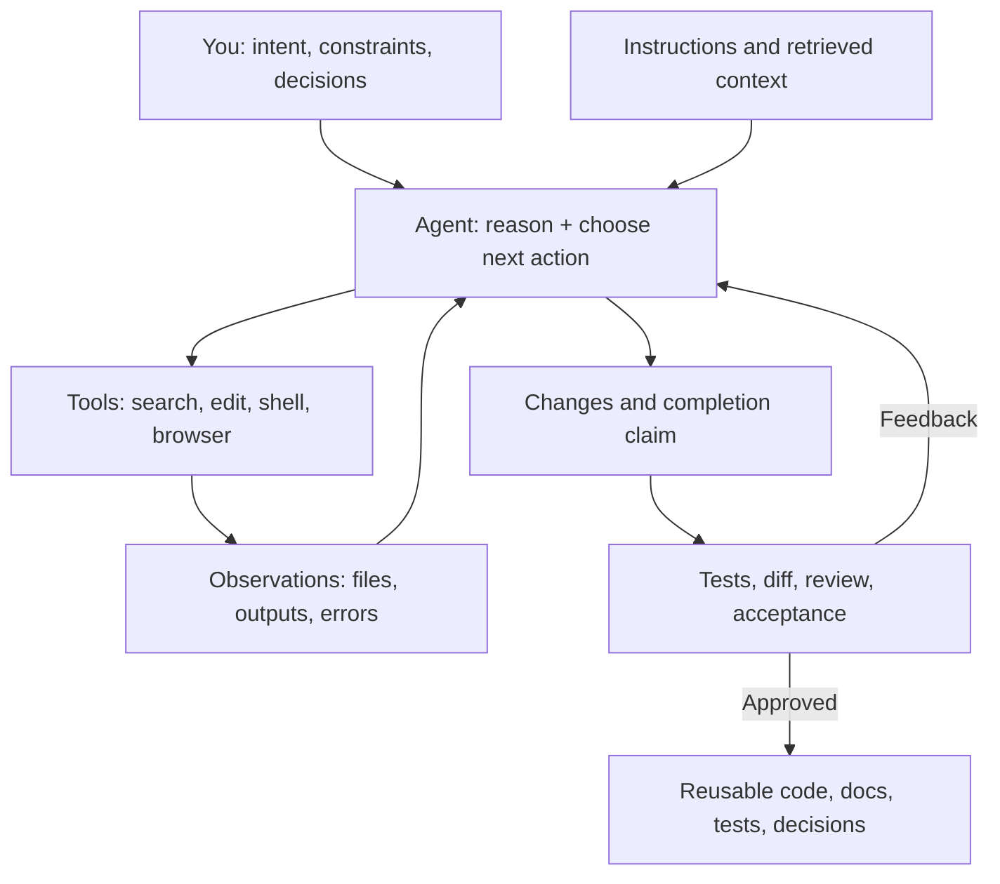

# The Human–AI Coding Partnership Blueprint

**Research-informed operating guide for web application development, documentation, and personal engineering growth**  
**Version:** 1.0 — 24 October 2026  
**Audience:** An individual web developer working with a repository-aware coding agent (Codex, Claude Code, Cursor, Copilot, or similar).

> **Core idea:** The goal is not to craft the perfect giant prompt. It is to build a reliable working relationship in which you provide product intent, judgment, context, and accountability; the agent contributes exploration, implementation, testing, and explanation; and the repository provides durable evidence of what is true.

**Scope note:** This is a tool-agnostic research synthesis, not an audit of your actual agent, repository, job, or workflow. The last section explains how to make it project-specific.

---

## 1. Executive findings: what the research suggests

1. **An agent is a loop, not a static chatbot.** In an agentic coding system, the model selects tools, observes file and command outputs, edits, and repeats until it stops. The quality of the outcome depends on the model **and** its tools, access, context, environment, and stopping criteria. [OpenAI, *Unrolling the Codex agent loop*](https://openai.com/index/unrolling-the-codex-agent-loop/).
2. **Context is a limited resource.** Large always-on instruction files can crowd out relevant code and task details. Prefer a short map to sources of truth and task-specific retrieval. [OpenAI, *Harness engineering*](https://openai.com/index/harness-engineering/); [Anthropic, *Effective context engineering*](https://www.anthropic.com/engineering/effective-context-engineering-for-ai-agents); [Cursor, *Customizing Agents*](https://prod.cursor.com/learn/customizing-agents).
3. **Verification is the hinge.** AI can accelerate first drafts while shifting effort to review. DORA's research describes a 'verification tax' and observes that AI can amplify strengths *and* weaknesses of the surrounding engineering system. [DORA, *Balancing AI tensions*](https://dora.dev/insights/balancing-ai-tensions/).
4. **Small, recoverable increments travel farther.** Research on long-running coding agents found that trying to build too much in one pass, losing context, and declaring success early led to failures. Feature-level progress, explicit checkpoints, and clean handoffs helped. [Anthropic, *Effective harnesses for long-running agents*](https://www.anthropic.com/research/effective-harnesses-for-long-running-agents).
5. **Personal productivity gains are not automatic.** A randomized study of experienced open-source developers measured a 19% slowdown with early-2025 tools. A later METR update saw signs of speedups but identified selection effects and unreliable timing, making the new estimate uncertain. These do **not** predict your personal outcome; they justify measuring it. [METR 2025](https://metr.org/blog/2025-07-10-early-2025-ai-experienced-os-dev-study/), [METR 2026 update](https://metr.org/blog/2026-02-24-uplift-update/).
6. **Your learning requires deliberate protection.** A small randomized trial (52 developers learning a new library) found that AI-assisted participants scored 17% lower on a follow-up mastery assessment on average; users who sought explanations and built understanding did better. Don't confuse shipped code with acquired skill. [Anthropic, *How AI assistance impacts the formation of coding skills*](https://www.anthropic.com/research/AI-assistance-coding-skills).
7. **Prompts do not enforce permissions.** Tool privileges, secrets, untrusted files, and third-party connectors introduce real risks, including indirect prompt injection. Use least privilege, isolated development environments, and human gates for high-risk actions. [OWASP Prompt Injection](https://genai.owasp.org/llmrisk/llm01-prompt-injection/); [OWASP 2026 incident roundup](https://genai.owasp.org/2026/10/08/genai-and-agentic-ai-exploit-roundup-q3-2026/).

### Inference from these sources

The strongest personal workflow has **six cooperating pieces**: (1) clear intent, (2) discoverable project context, (3) appropriate tools and permissions, (4) small execution units, (5) observed tests and human review, and (6) a learning loop that improves both the project and the developer. No single master prompt can replace all six.

---

## 2. Understand your coding agent as a system

### The practical mental model



Understand these boundaries:

| Dimension | What it means | Your collaboration move |
| --- | --- | --- |
| Context window | It processes a finite working set; long conversations and tool output compete for space. | Point it to exact files and decisions; restart with a concise handoff when needed. |
| Retrieval | It may know how to search but has not necessarily seen the relevant code. | Ask it to identify entry points and dependencies before cross-cutting work. |
| Tools | Capability depends on what it can actually read, run, edit, and inspect. | Make local scripts, a test DB, logs, and browser checks available when safe. |
| Permissions | It can perform only permitted actions; a prompt is not an authorization boundary. | Grant only necessary access; gate production and irreversible steps. |
| Confidence | A fluent explanation is not evidence that code was executed or behavior observed. | Require command results, file references, test evidence, and explicit unknowns. |
| Memory | Conversation continuity may compact or reset; project facts can go stale. | Store durable knowledge in code, tests, docs, and decision records. |
| Non-determinism | Two runs can choose different approaches. | Evaluate by acceptance criteria, not by how convincing the narrative sounds. |

**Key question for every agent interaction:** “What does it *know from inspection*, what is it *assuming*, and what has it *actually verified*?”

### The agent capability audit (run once, then after tool changes)

Ask your agent, in read-only mode:

> Inspect this repository and report: (1) what files and directories you can access, (2) how you determine application entry points, (3) what test/build/lint commands are available, (4) whether you can launch and inspect the UI, (5) whether you can access logs, databases, and API documentation, (6) what permissions require my approval, (7) what context persists across sessions, and (8) what you cannot verify. Do not change files. Give evidence for each answer.

Verify its report yourself. The audit exposes gaps in the **environment**, not just gaps in the prompt.

---

## 3. Divide responsibility deliberately

| Responsibility | You remain accountable for | Agent can contribute |
| --- | --- | --- |
| Problem definition | Why this matters; users, business rules, trade-offs, acceptance | Clarifying questions, requirements draft, edge-case discovery |
| Architecture | Boundaries, compatibility, long-term costs, significant decisions | Repository mapping, alternatives, trade-off analysis, small proof of concept |
| Implementation | Approval of approach and meaningful scope | Code edits, refactors, migration scripts, tests, documentation |
| Quality | Risk acceptance, sign-off, user experience | Test execution, static checks, bug reproduction, diff review, browser validation |
| Documentation | Accuracy, intended audience, ownership | Draft and update from verified implementation, API changes, ADR skeletons |
| Learning | Internalizing concepts and being able to debug independently | Teach-back, alternative explanations, quizzes, adversarial questions |
| Production | Release approval, data integrity, security, incident handling | Preparation, staging verification, rollback plan, observability analysis |

**Delegation is not abdication.** Decide *what* and *why*, and retain ownership of high-impact decisions. The agent may propose *how* and implement it. Anthropic's 2026 usage analysis describes a similar practical division of labor. [Source](https://www.anthropic.com/research/claude-code-expertise).

### Risk-based autonomy levels

| Level | Examples | Operating rule |
| --- | --- | --- |
| **L0: Explore** | Explain architecture, trace a request, inspect bug | Read-only; agent reports evidence. |
| **L1: Low-risk edits** | Copy changes, isolated UI fixes, tests, docs | Agent may implement and run safe local checks; you review diff. |
| **L2: Bounded feature work** | Feature in known module, API endpoint, component integration | Agree on acceptance criteria; execute small slices; verify changed paths. |
| **L3: Cross-cutting changes** | Authentication, schema, migration, payment, significant refactor | Written design and review checkpoint before implementation; compatibility and rollback plan. |
| **L4: High-consequence operations** | Production database actions, credential changes, deploy, delete, security exception | Explicit human approval, least privilege, controlled scripts, backups, audit trail. |

These levels are **a recommended operating policy**, not a built-in feature of a particular agent.

---

## 4. The collaboration loop: work together, not serially

For every meaningful task, run this cycle:

1. **Frame (you):** Specify the user-visible goal, reason, scope, constraints, and observable acceptance tests.
2. **Orient (agent):** Locate existing patterns, dependencies, relevant tests, and constraints. Report only the findings needed for the task.
3. **Decide (together):** Choose approach, name major assumptions, establish review gates. Complex/risky tasks get a short plan; trivial changes do not need ceremony.
4. **Execute (agent):** Change one cohesive slice at a time; avoid unrelated churn. Report blockers and important discoveries.
5. **Verify (tools + agent):** Run the smallest relevant test set, then broader checks proportionate to risk; exercise the UI and API where possible.
6. **Challenge (you):** Inspect behavior, diff, contract changes, security boundaries, and what was *not* tested. Ask the agent to explain or revise.
7. **Capture (agent + you):** Update affected docs and tests, record important decisions, produce a concise handoff; only durable lessons become persistent rules.

### Checkpoints instead of constant micromanagement

- **Checkpoint A — before code:** Required for architecture, data, permissions, multi-module changes. Review assumptions and trade-offs.
- **Checkpoint B — at first working vertical slice:** Check that data flows end-to-end and follows the project design.
- **Checkpoint C — before completion:** Review observed behavior, failures, changed API/schema contracts, tests, and docs.

For a tiny, low-risk edit, use only C. Avoid making the agent produce a long plan for every CSS or copy change.

### Completion contract

A task is not “done” because the agent says “implemented.” A meaningful change is done when:

- Acceptance criteria are demonstrated or marked as unverified.
- Relevant tests have been run and their results reported; failed or skipped checks are explicit.
- Scope and changed files are reviewable.
- Frontend states, accessibility, permissions, API contracts, and migrations receive appropriate checks.
- Documentation is updated **if observed behavior or an enduring contract changed**.
- Residual risks and follow-up tasks are visible.

---

## 5. Give the agent a useful project environment

**Priority order:** testability → discoverable project knowledge → reproducible local environment → clear task framing → refined prompts.

### Repository guide: short, navigational, maintained

Use the instructions mechanism supported by your tool, for example `AGENTS.md` (Codex and some others), `CLAUDE.md` (Claude Code), `.cursor/rules/`, or `.github/copilot-instructions.md` (GitHub Copilot). The exact applicability varies by product and execution surface; consult current product documentation. Do not assume these files are interchangeable. [GitHub documentation](https://docs.github.com/en/copilot/concepts/prompting-and-context/custom-instructions), [Cursor documentation](https://cursor.com/docs/rules).

**Example `AGENTS.md` skeleton** (adapt; do not blindly paste irrelevant sections):

```md
# Project guide

Purpose: [What this application does and for whom.]

## Find the truth
- Architecture and module boundaries: docs/architecture.md
- Domain terms and workflows: docs/domain.md
- API contract: [OpenAPI file or docs/api.md]
- Data models: [schema / migration paths]
- UI design patterns: [canonical component paths]

## Project-specific commands
- Install: [verified command]
- Start: [verified command]
- Fast tests: [verified command]
- Typecheck/lint/build: [verified commands]

## Constraints
- Follow the existing [pattern] in [example file].
- Do not change [specific protected areas] without approval.
- Ask before altering public APIs, authentication, persistent data, or deployment.
- Keep tasks reviewable; distinguish verified results from assumptions.

## Documentation
- When a public behavior or enduring contract changes, update its source-of-truth doc.
```

**Keep global instructions small.** OpenAI's September 2026 guidance cautions against repeatedly forcing full architecture/database/deployment docs into the context for trivial changes; tell the agent *when* to read them. [OpenAI, *Rethinking skills and prompts*](https://developers.openai.com/blog/rethinking-skills-and-prompts-for-gpt-6-astra).

### Build a system of record

| Source | Contains | Rule |
| --- | --- | --- |
| Code + tests | Actual behavior and executable expectations | Primary evidence, though tests can be incomplete. |
| API schema / migrations | Public contracts and persistent data changes | Prefer machine-readable schema where practical. |
| `docs/architecture.md` | Boundaries, data flow, dependencies | Explain decisions and pointers; avoid duplicating code. |
| `docs/domain.md` | Business terms, roles, invariants | Write user-intent constraints agents cannot infer. |
| `docs/decisions/` | Important decisions with alternatives and consequences | One record per consequential decision, not per tiny edit. |
| `docs/runbook.md` | Setup, troubleshooting, operational procedures | Verify commands rather than inventing instructions. |
| A task note / issue | Current goal, acceptance, remaining work | Disposable after task unless it captures durable knowledge. |

**Documentation rule:** Update the smallest authoritative document affected. Don't create a new `SUMMARY_FINAL_V3.md` on every run. Prefer generated API reference from OpenAPI/schema when tooling exists, and document human decisions separately.

### Make the app observable to the agent

- Reproducible local start and clean test data; separate dev/staging credentials.
- Fast targeted tests, typecheck, lint, build; CI as a final independent gate.
- Browser/UI inspection and screenshots where appropriate; test accessibility and responsive states.
- Logs and traces for error diagnosis with secret redaction.
- API examples, contract tests, database schema/migration tooling.
- Safe rollback and version-control checkpoints for significant work.

Tools and reliable feedback make more of a difference than instructions that merely say “be accurate.” OpenAI's harness engineering case study emphasizes app, browser, logs, and metrics being legible to the agent. [Source](https://openai.com/index/harness-engineering/).

---

## 6. Choose the right collaboration mode

| Mode | Your intent | Agent's deliverable | Do **not** do yet |
| --- | --- | --- | --- |
| **Explore / learn** | Understand system, architecture, library | Trace with referenced code, glossary, questions | Edit code |
| **Diagnose** | Find why behavior fails | Reproduction, hypotheses, evidence, root cause | Apply speculative fix |
| **Design** | Compare approaches for meaningful change | Options, risks, data flow, selected recommendation | Commit to major implementation before approval |
| **Implement** | Deliver accepted, scoped behavior | Code + focused tests + verified outcomes | Broaden requirements unasked |
| **Review** | Critique an existing diff | Severity-ranked issues with precise references | Reimplement unless asked |
| **Document** | Make project knowledge navigable | Changes grounded in current code/schema/tests | Invent behavior or duplicate stale docs |
| **Teach-back** | Grow your own engineering skill | Questions, explanation, conceptual check | Replace all your reasoning with generated answers |

Mix modes deliberately, but say when you want **read-only diagnosis** versus **implementation**. A common failure is asking “Why is this broken?” and receiving a large unreviewed patch.

---

## 7. Prompt patterns that create better collaboration

The examples below are task prompts. They complement — rather than replace — your project context and tools.

### A. Repository orientation (read-only)

```text
I want to understand [feature / user flow]. Trace the request from the UI
through services, API handlers, persistence, and back to the UI.
Reference the relevant files and existing tests. Separate observed facts from
inferences. Identify important domain rules, extension points, and unclear
areas. Do not modify code. End with three questions that would test whether
I genuinely understand this flow.
```

### B. Bug investigation (diagnose first)

```text
Bug: [observed behavior]. Expected: [expected behavior]. Reproduction:
[steps, inputs, environment]. Evidence: [logs, screenshots, errors].

Investigate in read-only mode first. Find the smallest reproducible case,
rank likely root causes, and show evidence for the leading explanation.
Identify a regression test that would fail before the fix. Stop for my
approval before changing code if the fix alters shared behavior or contracts.
```

### C. Feature implementation with shared decisions

```text
Outcome: [user-visible behavior and reason].
Constraints: [business rules, compatibility, architecture, non-goals].
Acceptance: [3–6 observable examples, including an error/edge case].
Reference pattern: [similar module/file if known].

Inspect relevant code and explain the approach briefly. For risky or
cross-cutting decisions, compare alternatives and ask me before editing.
Implement the smallest coherent end-to-end slice, then test it using existing
project commands. Update only affected documentation. Report files, results,
assumptions, and remaining risks. Do not deploy or commit without request.
```

### D. Architecture debate (push back)

```text
I am considering [design]. Act as a constructive technical reviewer.
First restate requirements and invariants. Compare at least two viable
approaches against performance, complexity, security, migration cost,
maintainability, and team conventions. Show what repo facts support each
claim. Challenge my assumptions. Recommend one approach and identify what
evidence would cause you to change that recommendation. No code changes.
```

### E. Senior-style code review

```text
Review the current diff against [task/requirements]. Prioritize correctness,
authorization, data integrity, concurrency, failure handling, API compatibility,
security, accessibility, and tests. Report findings by severity with exact
file locations and reproducible reasoning. Distinguish verified bugs from
possible risks. Do not list generic style nits or modify code.
```

### F. Documentation audit

```text
Compare [docs location] with the actual implementation and tests for
[specific module]. Identify stale, missing, duplicated, or unverifiable
claims. Propose the smallest doc update, showing evidence from code/schema.
Do not make up routes, config values, or guarantees. Implement the doc change
only after verifying the source behavior.
```

### G. Mentoring / skill development

```text
For this task, act as my engineering mentor. Let me explain my approach
first. Challenge my reasoning with questions and edge cases. Give hints
before complete solutions, unless I explicitly request implementation.
Afterward, ask me to explain the final code path, likely failure modes,
and what I would change without AI assistance.
```

### H. Recovery after an agent stalls or drifts

```text
Stop editing. State the original goal, the current observable status,
changed files, tests actually run, failed assumptions, and the next
smallest safe action. Check whether unrelated changes occurred. Do not
claim completion. Propose a plan that preserves working code and ask me
only for the missing decision that materially blocks progress.
```

**Prompting principle:** Add examples, acceptance criteria, and *specific facts*, not repeated generic commands to “think harder” or “act like an expert.”

---

## 8. Human review: what you personally must look for

**Use six review lenses** for meaningful changes:

1. **Product:** Did we build the right user behavior and handle real edge cases?
2. **Contracts:** Are API schemas, errors, data invariants, and backward compatibility intact?
3. **Security:** Are authn/authz, input validation, secrets, dependencies, and trust boundaries sound?
4. **Resilience:** What happens with retries, timeouts, network failure, concurrency, partial writes, and invalid state?
5. **Experience:** Do UI flows work across loading, empty, error, keyboard, and mobile states?
6. **Maintainability:** Is the diff small, idiomatic, tested, observable, and documented where needed?

Read the **behavioral path** rather than merely skimming a diff. For critical code, explain in your own words how data flows and who is permitted to do what.

### Independent checks are more reliable than repeated reassurance

Prefer a failing regression test, static analysis, manual UI reproduction, or contract assertion over prompting “Are you absolutely sure?” An agent can agree with its earlier answer. A separate observable check provides a different kind of evidence.

### Secure boundaries

- Use a development sandbox or isolated worktree for experiments.
- Do not grant production write access by default.
- Keep credentials in approved secret stores; don't paste them into prompt files, screenshots, tickets, or logs.
- Treat repository comments, web pages, tool results, and third-party agent integrations as potentially untrusted input.
- Review new agent configuration files, tool permissions, and package scripts before enabling them.
- Require explicit approval and a rollback strategy for migrations, production operations, deletions, and irreversible steps.

**Why this matters:** OWASP documents indirect prompt injection and 2026 incidents involving compromised agent configurations and third-party tooling. These are tool and permission problems; a “please ignore malicious instructions” sentence alone cannot make them safe. [OWASP](https://genai.owasp.org/llmrisk/llm01-prompt-injection/), [2026 roundup](https://genai.owasp.org/2026/10/08/genai-and-agentic-ai-exploit-roundup-q3-2026/).

---

## 9. Protect and compound your engineering expertise

Your long-term advantage comes from strengthening the skills that let you **direct, challenge, and verify** increasingly capable systems.

### A practical “AI + deliberate practice” routine

- **Before asking:** Spend 3–5 minutes writing your hypothesis, expected files, or high-level design. Then compare with the agent's findings.
- **During implementation:** Ask it to expose one important trade-off and one failure mode, not to explain every line.
- **After implementation:** Without looking at its summary, explain the changed call path and where you would put a breakpoint.
- **Weekly:** Personally implement one bounded concept or debug one issue before seeing the agent's solution.
- **Monthly:** Choose one unfamiliar module and build a short architecture map or teach-back note.

Use **teach-back tests**:

1. What invariant does this code enforce?
2. Where is the authorization boundary?
3. What happens when the API returns 429, 500, or malformed data?
4. How would we prove the fix without looking at generated code?
5. What is the simplest safe rollback?

Don't turn this into constant homework. Use deeper learning mode for unfamiliar, high-risk, or career-relevant technologies; delegate rote and familiar work more freely.

---

## 10. Measure whether the partnership is actually improving

Don't optimize for number of AI prompts, tokens consumed, commits, or lines of generated code. Track *accepted useful outcomes* and personal understanding.

### Lightweight task journal

For 10–20 real tasks, record the same fields:

| Field | Example |
| --- | --- |
| Task type/risk | Bug, L1; feature, L2; auth migration, L3 |
| Size/complexity | One component, multi-module, unknown codebase |
| Human time | Framing 10m + review 15m + corrections 20m |
| Agent time/cost | Optional if tool reports it |
| Rework | 2 corrective iterations, 4 files touched |
| Evidence | Unit tests pass; browser check absent |
| Outcome | Accepted / partial / rejected / reverted |
| Documentation | Source doc updated and checked |
| Learning | Can explain main flow unaided: yes/no |

### Weekly metrics

1. **Accepted-task lead time:** From clear task start to reviewed, working change.
2. **First-pass acceptance rate:** Share of scoped tasks needing no significant rework.
3. **Correction burden:** Your time spent fixing or clarifying agent output.
4. **Escaped defect count:** Bugs discovered after you accepted the work.
5. **Verification coverage:** Fraction of changed paths with appropriate observed checks.
6. **Documentation drift:** Materially incorrect docs found during work.
7. **Personal understanding:** Could you explain, debug, and modify the delivered feature yourself?

**Avoid fake precision.** Compare tasks of similar risk and complexity. Small samples and changing models/tools limit causal conclusions. METR's 2026 update is a good reminder that selection effects can undermine productivity measurement.

---

## 11. A four-week adoption experiment

### Week 1 — Observe and baseline

- Audit current agent capabilities and permissions.
- Select 5 representative recent tasks: bug, feature, refactor, docs, learning.
- Document your current workflow and estimate review/correction time.
- Identify the top three recurring sources of friction.
- Create a short repository guide linking to true project knowledge.

**Exit condition:** You know what the agent can *actually* see, do, and verify.

### Week 2 — Establish the working contract

- Use Frame → Orient → Decide → Execute → Verify → Challenge → Capture on 3–5 tasks.
- Introduce risk levels and design approval gates.
- Keep tasks small enough for a meaningful single review.
- Practice read-only diagnosis on one bug before authorizing a fix.

**Exit condition:** Completion claims have evidence, and you can see where decisions were made.

### Week 3 — Improve the environment

- Add or repair a fast test command and project setup procedure.
- Make one recurring UI/API scenario observable end to end.
- Remove repeated instructions that don't help; turn recurring verified failures into a test, tooling constraint, or focused rule.
- Audit one documentation area against source behavior.

**Exit condition:** The next agent run has a better environment rather than just more words.

### Week 4 — Review results and calibrate

- Compare outcomes against Week 1; account for task mix.
- Identify tasks you should delegate more and tasks where you should stay close.
- Remove stale rules and duplicate docs.
- Choose one concept to learn deeply based on actual review/debugging gaps.
- Draft a personalized playbook v2.

**Exit condition:** You have evidence of what works for your specific tool, repository, and responsibilities.

---

## 12. Failure patterns and the matching remedy

| Failure you observe | Likely underlying issue | Better intervention |
| --- | --- | --- |
| Agent edits wrong module | Missing context or a misleading search hit | Name canonical entry point/example; have it trace the path first. |
| Repeats same mistake | Missing executable guard or real local rule | Add regression test/lint/check; then a short rule if still needed. |
| Produces huge PR | Scope too broad, no checkpoints | Split vertical slices and require diff review after the first slice. |
| Claims success despite failure | No observable finish criterion | Provide reproducible acceptance tests, run checks, report actual results. |
| Slow or distracted | Excessive context, repeated instructions, irrelevant docs | Trim always-on rules; use targeted retrieval and a fresh handoff. |
| Breaks auth or API compatibility | No explicit invariant or contract test | Specify invariants and add negative tests; review design at L3. |
| Documentation looks polished but false | Text generated without source comparison | Require file/schema evidence and a docs audit. |
| You can no longer explain your own code | Over-delegation in unfamiliar area | Use mentoring mode and teach-back; implement a small slice yourself. |
| Agent asks too many minor questions | Approval boundary too vague | Define safe reversible actions, risk levels, and decisions requiring consent. |
| Agent silently overreaches | Tool permissions too broad | Restrict credentials, sandbox writes, review tools and automation configuration. |

---

## 13. Personalization interview: convert this into *your* blueprint

The following questions materially change the recommendations:

1. **Agent:** Which tool(s), model, IDE/CLI, modes, permissions, and integrations do you use? Does it access the repo directly?
2. **Stack:** Frontend, backend, database, auth, CI/CD, hosting, monorepo structure, tests, documentation style?
3. **Job:** Role and seniority; individual contributor or lead; how work arrives (tickets, meetings, support, feature requests)?
4. **Work mix:** Approximate weekly split between features, debugging, refactoring, reviews, testing, docs, and deployment?
5. **Pain:** Three specific times the agent wasted effort, misunderstood the app, or produced work you couldn't trust?
6. **Boundaries:** Company AI policy, proprietary code/secrets, permissions, production access, mandatory review?
7. **Growth goal:** Better architecture, faster output, confidence in reviews, technical leadership, domain expertise, or another priority?

### Artifact set for a project-specific Version 2

With these answers and appropriate permission to inspect a repo, create:

- A brief **agent capability and context audit**.
- A project-specific **human–agent responsibility contract**.
- A **repository knowledge map** and small native instruction files, tailored to the selected agent.
- A **task intake template** with definition of ready and done.
- **Feature, bug, review, architecture, and documentation** playbooks with real code paths.
- A **risk and approval matrix** reflecting work policy.
- A **verification matrix** and documentation change triggers.
- A **weekly measurement sheet** and retrospective cadence.
- A **developer learning plan** focused on the skills you want to retain and build.

---

## 14. Research log and caveats

This blueprint is based on primary technical documentation, original engineering reports, and research available as of **24 October 2026**. Some vendor findings are from the vendor's own products or internal teams; they are useful engineering evidence but not universal comparisons. The METR and learning trials are informative but task- and population-specific. No source proves that a particular prompt or operating system is globally “best.”

**Most consequential sources:**

1. OpenAI — [Unrolling the Codex agent loop](https://openai.com/index/unrolling-the-codex-agent-loop/): tool loop and context limits.
2. OpenAI — [Harness engineering](https://openai.com/index/harness-engineering/): legible tools, repository knowledge, verifiable constraints.
3. OpenAI — [Rethinking skills and prompts for GPT-6 Astra](https://developers.openai.com/blog/rethinking-skills-and-prompts-for-gpt-6-astra): reduce overinstruction and read context selectively.
4. Anthropic — [Effective context engineering](https://www.anthropic.com/engineering/effective-context-engineering-for-ai-agents): context retrieval, compaction, structured notes.
5. Anthropic — [Effective harnesses for long-running agents](https://www.anthropic.com/research/effective-harnesses-for-long-running-agents): incremental feature work and durable handoffs.
6. Anthropic — [Harness design for long-running apps](https://www.anthropic.com/research/harness-design-long-running-apps): design, generation, evaluation and simplifying complexity.
7. Anthropic — [How AI assistance impacts coding skills](https://www.anthropic.com/research/AI-assistance-coding-skills): experimental evidence for deliberate understanding.
8. METR — [2025 developer productivity RCT](https://metr.org/blog/2025-07-10-early-2025-ai-experienced-os-dev-study/) and [2026 methodology update](https://metr.org/blog/2026-02-24-uplift-update/): mixed, uncertain productivity outcomes.
9. DORA — [2025 State of AI-assisted Software Development](https://dora.dev/research/2025/dora-report/) and [2026 practitioner analysis](https://dora.dev/insights/balancing-ai-tensions/): AI as amplifier, delivery trade-offs, verification costs.
10. GitHub — [Copilot custom instructions](https://docs.github.com/en/copilot/concepts/prompting-and-context/custom-instructions): supported instruction scopes and constraints.
11. Cursor — [Customizing agents](https://prod.cursor.com/learn/customizing-agents): focused project rules, patterns, commands, guardrails.
12. OWASP — [Prompt injection](https://genai.owasp.org/llmrisk/llm01-prompt-injection/) and [Q3 2026 incidents](https://genai.owasp.org/2026/10/08/genai-and-agentic-ai-exploit-roundup-q3-2026/): security risks of agent tools and context.

### Final north star

**Better engineering outcomes + less avoidable rework + stronger personal understanding.** If only generated code volume increases, the system has not yet succeeded.
